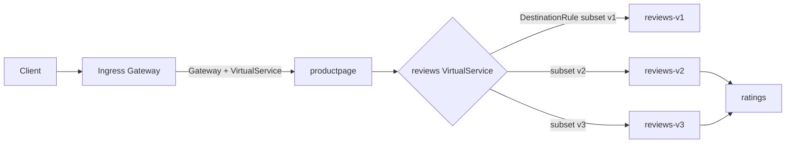

# Istio Learning Lab

Hands-on lab for learning Istio service mesh on a local Kubernetes cluster (minikube), using the Bookinfo sample app. Each topic has a manifest, the commands to run it, and the result to expect.

Tested on: macOS (Apple Silicon), minikube with Kubernetes v1.35.1, Istio 1.31.2 (demo profile).

## What Istio adds

Istio injects a sidecar proxy next to each pod. The sidecars handle routing, security and telemetry, so none of it needs application code changes.



| Object | Role |
|---|---|
| Gateway | Opens a port on the ingress gateway for outside traffic |
| VirtualService | Routing rules: match a request, pick a destination, set weights, faults and timeouts |
| DestinationRule | Names the versions (subsets) by pod label and sets connection and outlier policies |
| PeerAuthentication | Sets the mTLS mode for pods in a namespace |

## Topics and status

| # | Topic | Manifests | Status |
|---|---|---|---|
| 0 | Admission controllers (mutating and validating) | [00-admission-controllers](manifests/00-admission-controllers) | Verified |
| 1 | Install Istio and deploy Bookinfo | [01-bookinfo](manifests/01-bookinfo) | Verified |
| 2 | Request routing (all v1, route by user header) | [02-request-routing](manifests/02-request-routing) | Verified |
| 3 | Traffic shifting (canary 50/50 and 90/10) | [03-traffic-shifting](manifests/03-traffic-shifting) | Verified |
| 4 | mTLS (STRICT and PERMISSIVE) | [04-mtls](manifests/04-mtls) | Verified |
| 5 | Circuit breaking | [05-circuit-breaking](manifests/05-circuit-breaking) | Not yet run |
| 6 | Fault injection and timeouts | [06-fault-injection](manifests/06-fault-injection) | Not yet run |
| 7 | Observability (Kiali, Jaeger, Grafana) | [docs/lab-guide.md](docs/lab-guide.md#step-9-observability) | Not yet run |

## Results observed

| Experiment | Result |
|---|---|
| ResourceQuota admission | A pod requesting 10Gi against a 2Gi quota was rejected with `Forbidden: exceeded quota` |
| Mutating admission | A PVC with no `storageClassName` was given `standard` automatically |
| 50/50 split | 10 of 20 requests returned v1 (no stars) and 10 returned v3 (red stars) |
| 90/10 split | 19 of 20 requests returned v1 and 1 returned v3 |
| STRICT mTLS | A pod without a sidecar went from HTTP 200 to a refused connection (curl exit 56); pods with sidecars and the gateway still returned 200 |

## Quick start

Prerequisites: `docker`, `minikube`, `kubectl`, `istioctl`.

```bash
./scripts/setup.sh                 # minikube + Istio + Bookinfo
kubectl port-forward -n istio-system svc/istio-ingressgateway 8080:80
# open http://localhost:8080/productpage
```

Follow [docs/lab-guide.md](docs/lab-guide.md) for each topic, and clean up with:

```bash
./scripts/cleanup.sh --stop
```

## Credits and license

Apache License 2.0. Based on [iam-veeramalla/istio-guide](https://github.com/iam-veeramalla/istio-guide) and the Istio Bookinfo sample. See [NOTICE](NOTICE).
